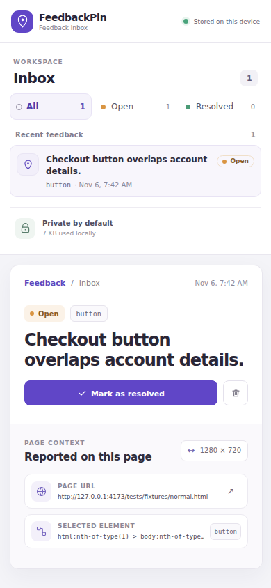

# FeedbackPin

[Русская версия](#русская-версия) · [English](#english)

## Русская версия

FeedbackPin — локальное расширение Chrome для структурированных замечаний к конкретным элементам веб-страницы. В отчёте сохраняются комментарий, безопасный путь к элементу, очищенный URL и размеры окна браузера. Данные остаются в профиле Chrome.

### Возможности

- Режим выбора запускается только после явного действия: откройте расширение и нажмите **Select an element**.
- Расширение ненавязчиво подсвечивает элемент и открывает компактную форму для комментария.
- Снимки экрана отключены ради приватности: поздняя инъекция не может обнаружить каждый закрытый Shadow DOM и исключить из снимка значения чувствительных полей.
- Замечания сохраняются без изображения. Панель управления позволяет просматривать, фильтровать, помечать исправленными и удалять их.
- Отчёты хранятся локально в IndexedDB. Панель показывает приблизительный объём занятого места, если Chrome предоставляет эту информацию.

У FeedbackPin нет аккаунтов, сервера, сетевой отправки отчётов, аналитики или командного пространства. Это небольшой инструмент для передачи замечаний разработчику.

### Скриншоты




Это настоящие снимки собранного расширения, созданные в удалённом CI на локальном тестовом примере. Сам продукт не делает скриншоты страниц; новые замечания содержат только текст и метаданные.

### Установка в Chrome

1. Соберите расширение командами `npm ci` и `npm run build`.
2. Откройте `chrome://extensions` и включите **Режим разработчика**.
3. Нажмите **Загрузить распакованное расширение** и выберите папку `dist/`.
4. Закрепите FeedbackPin, откройте обычный сайт и нажмите **Select an element** во всплывающем окне расширения.

В production-манифесте запрашиваются только разрешения `activeTab` и `scripting`. Скрипт не запускается автоматически при загрузке страниц; разрешений на все сайты нет. Chrome запрещает инъекцию расширений на некоторых служебных страницах, например `chrome://`.

### Разработка и проверки

Нужны Node.js 22.12 или новее и npm.

```sh
npm ci
npm run dev
npm run lint
npm run typecheck
npm test
npm run build
npx playwright install chromium
npm run test:e2e
```

`npm run dev` запускает локальные тестовые страницы и исходный код расширения. `npm run test:e2e` собирает и загружает временную копию расширения в Chromium. Эта тестовая копия получает разрешения, нужные для автоматизации локальных страниц; production-манифест отдельно проверяется на наличие только `activeTab` и `scripting`.

### Архитектура

- `src/background.ts` — событийный service worker MV3. Он запускает выбор элемента после действия во всплывающем окне и записывает проверенные текстовые отчёты.
- `src/content/` — небольшой скрипт на TypeScript без React; он временно добавляет интерфейс в изолированный Shadow DOM. Этот скрипт не запускается при загрузке страницы.
- `src/popup/` и `src/dashboard/` — страницы расширения на React.
- `src/shared/db.ts` — хранение отчётов в IndexedDB. Уже сохранённые в старых сборках изображения сохраняются.

Проверка production-манифеста также подтверждает, что скрипт выбора работает без загрузки дополнительных модулей.

### Приватность и ограничения

- Комментарии и отчёты остаются в текущем профиле Chrome, пока пользователь их не удалит.
- Значения полей, текст DOM, произвольные атрибуты, параметры запроса URL и его фрагмент не сохраняются как метаданные отчёта.
- Новые скриншоты не создаются и не хранятся. Поэтому расширению не нужны API захвата экрана, обработка изображений и размывание чувствительных данных.
- Изображения, сохранённые в ранних локальных сборках, остаются в существующих отчётах, пока пользователь не удалит их.
- Путь к DOM-элементу служит подсказкой и может устареть, если сайт изменится.
- Нет облачной синхронизации, совместной работы, авторизации и автоматического удаления старых отчётов.

### Производительность

Код на странице отсутствует до запуска выбора элемента; при закрытии режима временные обработчики удаляются. Измерения CPU, памяти процессов, запуска выбора и повторных циклов проведены в Chromium на удалённом GitHub Actions runner. Методика, числа и ограничения описаны в [docs/performance.md](docs/performance.md). Эти результаты не измеряют нагрузку на конкретный ноутбук.

### Документы проекта

- [Спецификация MVP](docs/specs/feedbackpin-mvp.md)
- [План реализации MVP](docs/plans/2026-11-04-feedbackpin-mvp.md)
- [Записи TDD](docs/tdd/)
- [Измерения производительности](docs/performance.md)
- [Итоговый независимый аудит](docs/audits/final-gpt6-luna-high.md)

Перед выпуском запускайте `npm run lint`, `npm run typecheck`, `npm test`, `npm run test:e2e` и `npm run build`. Публичный репозиторий не означает публикацию в Chrome Web Store.

---

## English

FeedbackPin is a local-first Chrome extension for leaving structured bug notes on the page element that needs attention. A report keeps a short comment, a safe element path, a sanitized URL, and viewport dimensions in the current browser profile.

## What it does

- Starts element selection only after you open the extension and choose **Select an element**.
- Adds a quiet highlight and compact note form to the current page.
- Disables screenshots because late on-demand injection cannot guarantee detection of every closed ShadowRoot and could capture private field values.
- Explains the screenshot limitation in the note form and saves text-only reports.
- Stores reports in IndexedDB on the extension device. The dashboard filters open and resolved notes and lets you change status or delete a report.
- Shows approximate local storage usage when Chrome provides it; estimate errors do not block report management.

FeedbackPin has no account, backend, network reporting, analytics, or team workspace. It is a focused handoff tool, not a project tracker.

## Screenshots


These are real screenshots of the built extension using a synthetic local fixture in remote CI. The product itself does not capture page screenshots; the dashboard shows a note without an image for privacy.

## Install in Chrome

1. Build the extension with `npm ci` and `npm run build`.
2. Open `chrome://extensions` and enable **Developer mode**.
3. Choose **Load unpacked** and select the generated `dist/` directory.
4. Pin FeedbackPin, open a regular website, and choose **Select an element** from the extension popup.

The production manifest requests only `activeTab` and `scripting`. It does not register page scripts or host permissions. Chrome restricted pages such as `chrome://` do not allow extension injection.

## Develop and verify

Use Node.js 22.12 or newer and npm.

```sh
npm ci
npm run dev
npm run lint
npm run typecheck
npm test
npm run build
npx playwright install chromium
npm run test:e2e
```

`npm run dev` serves the local fixtures and extension source for development. `npm run test:e2e` builds and loads a temporary copy of the extension in Chromium. That test copy adds permissions required to automate local pages; the generated production manifest is separately checked to contain only `activeTab` and `scripting`.

## Architecture

- `src/background.ts` is an event-driven MV3 service worker. It injects the selector after the popup action and writes validated text reports.
- `src/content/` is a small plain TypeScript script with a temporary Shadow DOM overlay. It is not registered for page load and does not use React.
- `src/popup/` and `src/dashboard/` are React extension pages.
- `src/shared/db.ts` stores reports in IndexedDB and preserves image blobs from earlier development builds.

The manifest guard also checks that the injected selector is a self-contained script, with no runtime module import.

## Privacy and limits

- Comments and reports remain in the current browser profile until deleted.
- Page field values, DOM text, arbitrary attributes, URL query strings, and URL fragments are not stored as report metadata.
- No page screenshot is captured or stored for new reports. The explicit privacy decision removes capture API, redaction, and image-processing work from the product.
- Images saved by earlier local development builds are preserved and remain visible in their existing report until the user deletes that report.
- Element paths are structural hints and may become stale when a site changes its DOM.
- There is no cloud sync, collaboration, authentication, or automatic retention cleanup.

## Performance

The implementation keeps page code absent until selection starts and removes its temporary listeners when selection closes. A sequential Chromium run in remote GitHub Actions measured CPU, process RSS, selector startup, page tasks, and repeated open/close cycles; conditions, numbers, and limits are in [docs/performance.md](docs/performance.md). These hosted-runner results do not predict the user's laptop's resource use.

## Project records

- [Approved MVP specification](docs/specs/feedbackpin-mvp.md)
- [Implementation plan](docs/plans/2026-11-04-feedbackpin-mvp.md)
- [TDD evidence](docs/tdd/)
- [Performance status](docs/performance.md)

Run `npm run lint`, `npm run typecheck`, `npm test`, `npm run test:e2e`, and `npm run build` before proposing a release. A public repository is not a Chrome Web Store listing.
