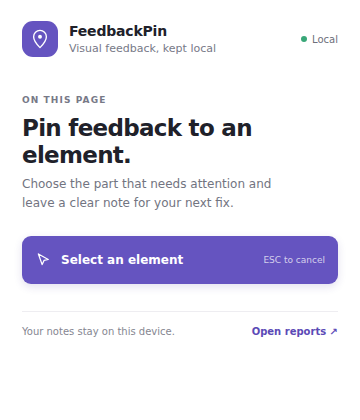
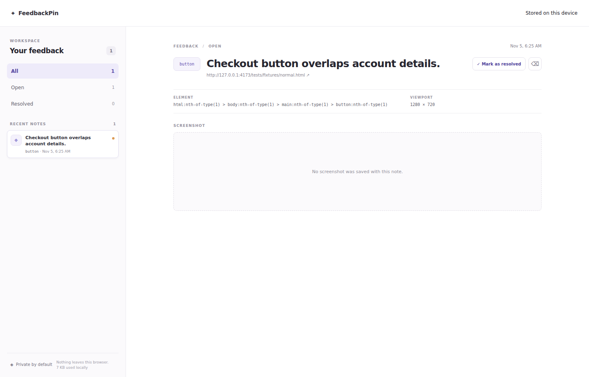

# FeedbackPin

FeedbackPin is a local-first Chrome extension for leaving structured bug notes on the page element that needs attention. A report keeps a short comment, a safe element path, a sanitized URL, and viewport dimensions in the current browser profile.

## What it does

- Starts element selection only after you open the extension and choose **Select an element**.
- Adds a quiet highlight and compact note form to the current page.
- Disables screenshots because late on-demand injection cannot guarantee detection of every closed ShadowRoot and could capture private field values.
- Explains the screenshot limitation in the note form and saves text-only reports.
- Stores reports in IndexedDB on the extension device. The dashboard filters open and resolved notes and lets you change status or delete a report.
- Shows approximate local storage usage when Chrome provides it; estimate errors do not block report management.

FeedbackPin has no account, backend, network reporting, analytics, or team workspace. It is a focused handoff tool, not a project tracker.

## Screenshots





These are real screenshots of the built extension using a synthetic local fixture in remote CI. The product itself does not capture page screenshots; the dashboard shows a note without an image for privacy.

## Install in Chrome

1. Build the extension with `npm ci` and `npm run build`.
2. Open `chrome://extensions` and enable **Developer mode**.
3. Choose **Load unpacked** and select the generated `dist/` directory.
4. Pin FeedbackPin, open a regular website, and choose **Select an element** from the extension popup.

The production manifest requests only `activeTab` and `scripting`. It does not register page scripts or host permissions. Chrome restricted pages such as `chrome://` do not allow extension injection.

## Develop and verify

Use Node.js 22.12 or newer and npm.

```sh
npm ci
npm run dev
npm run lint
npm run typecheck
npm test
npm run build
npx playwright install chromium
npm run test:e2e
```

`npm run dev` serves the local fixtures and extension source for development. `npm run test:e2e` builds and loads a temporary copy of the extension in Chromium. That test copy adds permissions required to automate local pages; the generated production manifest is separately checked to contain only `activeTab` and `scripting`.

## Architecture

- `src/background.ts` is an event-driven MV3 service worker. It injects the selector after the popup action and writes validated text reports.
- `src/content/` is a small plain TypeScript script with a temporary Shadow DOM overlay. It is not registered for page load and does not use React.
- `src/popup/` and `src/dashboard/` are React extension pages.
- `src/shared/db.ts` stores reports in IndexedDB and preserves image blobs from earlier development builds.

The manifest guard also checks that the injected selector is a self-contained script, with no runtime module import.

## Privacy and limits

- Comments and reports remain in the current browser profile until deleted.
- Page field values, DOM text, arbitrary attributes, URL query strings, and URL fragments are not stored as report metadata.
- No page screenshot is captured or stored for new reports. The explicit privacy decision removes capture API, redaction, and image-processing work from the product.
- Images saved by earlier local development builds are preserved and remain visible in their existing report until the user deletes that report.
- Element paths are structural hints and may become stale when a site changes its DOM.
- There is no cloud sync, collaboration, authentication, or automatic retention cleanup.

## Performance

The implementation keeps page code absent until selection starts and removes its temporary listeners when selection closes. Production bundle sizes and the unmeasured browser-performance matrix are recorded in [docs/performance.md](docs/performance.md). CPU, memory, long-task, responsiveness, and repeated-open measurements are not claimed until they can be collected safely in Chromium.

## Project records

- [Approved MVP specification](docs/specs/feedbackpin-mvp.md)
- [Implementation plan](docs/plans/2026-11-04-feedbackpin-mvp.md)
- [TDD evidence](docs/tdd/)
- [Performance status](docs/performance.md)

Run `npm run lint`, `npm run typecheck`, `npm test`, `npm run test:e2e`, and `npm run build` before proposing a release. A public repository is not a Chrome Web Store listing.
